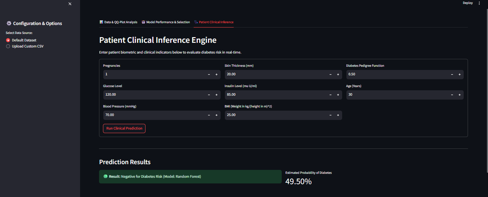
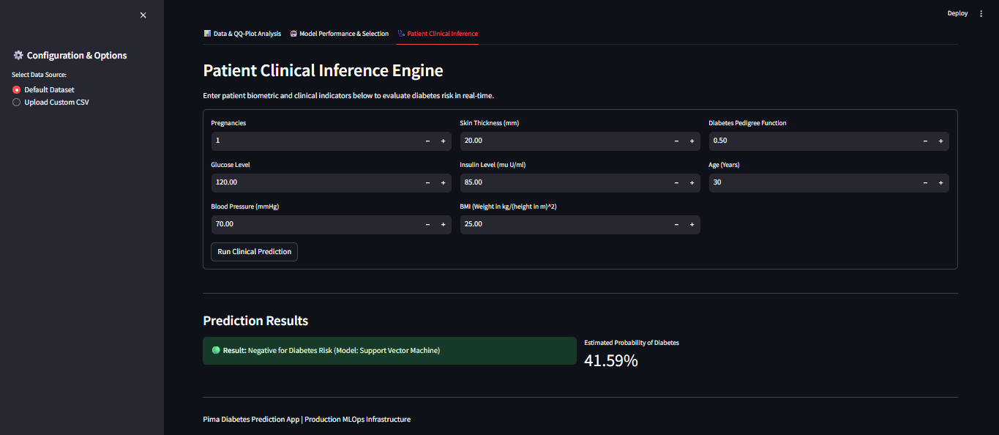
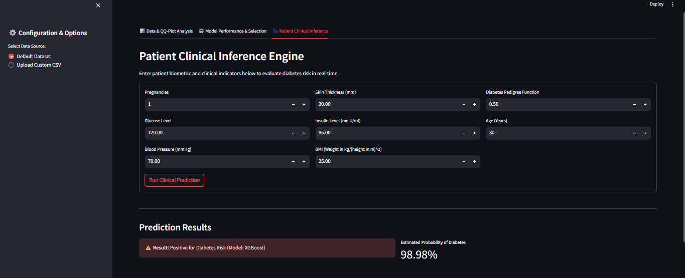

[](https://github.com/Arjunssolanki/pima-diabetes-prediction-app/actions/workflows/ci.yaml)

# 📊 Pima Diabetes Prediction App

A production-grade, MLOps-compliant Machine Learning application designed to predict diabetes risk using patient biomarkers. This project connects a secure cloud data lake to automated statistical engines, feature optimization routines, and a real-time interactive web dashboard.

---

## 💡 Project Summary (In Simple Terms)

Imagine you have medical information from patients (like blood pressure, age, insulin, and glucose levels), and you want to predict whether a new patient has a high risk of developing diabetes.

This application does exactly that. It takes raw medical data directly from a secure cloud storage center (AWS S3), runs it through a series of "smart cleaning filters" to fix skewed or weirdly shaped numbers, selects the most important features, and trains three different AI models to find the most accurate predictor. Finally, it packages everything into a simple web dashboard where a doctor or user can input a patient's numbers and instantly see a diagnostic risk evaluation with percentage confidence.

---

## 🏗️ MLOps Architecture & Data Flow

Below is the production pipeline flow showing how artifacts are handled across our decoupled components:

## 🏗️ Architectural Workflow

The project is decoupled into modular steps ensuring reproducibility, testability, and clean code separation:

```text
[ Data Ingestion ] ──> [ Advanced EDA & QQ-Plots ] ──> [ Data Transformation ]
                                                                │
                                                                ▼
[ Model Testing & Tuning ] <── [ Feature Selection ] <── [ Scaling / Pipeline ]
          │
          ▼
[ Streamlit Deployment ] ──> [ Continuous Monitoring / MLOps Loop ]
```

---

## 📂 Repository Structure

pima-diabetes-prediction-app/
│
├── .github/
│ └── workflows/
│ └── ci.yaml # CI/CD pipeline for automated build & testing
├── app/
│ └── main.py # Streamlit interactive web application
├── data/
│ ├── processed/ # Cleaned and normalized datasets (diabetes_clean.csv)
│ └── raw/ # Unprocessed original data from S3
├── models/ # Serialized production model binaries (.pkl / .joblib)
├── notebooks/ # Scratchpad notebooks for exploratory data analysis
├── src/
│ ├── **init**.py
│ ├── data_loader.py # Cloud ingestion and schema validation scripts
│ ├── feature_selection.py # L1 regularization and variance thresholding
│ ├── preprocessing.py # QQ-plot analysis, Box-Cox, and Yeo-Johnson transformers
│ └── train.py # Multi-model training suite, SMOTE integration, & tuning
├── tests/
│ └── test_preprocessing.py # Unit tests for transformation logic and pipeline stability
├── .gitignore
├── config.yaml # Centralized configuration (S3 paths, parameters, columns)
├── README.md # Project documentation
└── requirements.txt # Environment dependencies

# 🔬 Data Preparation, Cleaning & ML Methods Explained

To build a high-performing model on medical data where distributions are notoriously skewed, we implemented several advanced techniques:

## 1. Normality Testing & Power Transformations (`src/preprocessing.py`)

- **The Problem:** Continuous features in healthcare datasets (such as `Insulin`, `SkinThickness`, and `DiabetesPedigreeFunction`) often exhibit severe right-skewness and fail statistical normality checks (e.g., the Shapiro-Wilk test).
- **The Solution:** We deployed adaptive mathematical power transformations—**Box-Cox** (for strictly positive data) and **Yeo-Johnson** (handles zero/negative values)—to stabilize variance and transform skewed distributions closer to a Gaussian normal shape.
- **Why it Helps:** Normalizing features reduces extreme outlier leverage, prevents magnitude bias during scaling, and allows linear algorithms and distance-based models (like SVMs) to map decision boundaries much more cleanly.

## 2. Efficiency Optimization & Feature Selection (`src/feature_selection.py`)

- **The Technique:** Applied **LASSO (L1 Regularization)** combined with standard scaling.
- **Why it Helps:** L1 regularization introduces a penalty proportional to the absolute value of the coefficients, effectively shrinking noise variables to zero. Interestingly, because our adaptive power transformations already cleaned and stabilized the feature variances, every feature provided distinct non-linear predictive signals, ensuring maximum information retention without noise.

## 3. Handling Class Imbalance via SMOTE (`src/train.py`)

- **The Problem:** The Pima dataset suffers from class imbalance (~65% healthy vs. ~35% diabetic). Naive models can exploit this by guessing the majority class to achieve a false sense of high accuracy.
- **The Solution:** Integrated **SMOTE (Synthetic Minority Over-sampling Technique)** during training preprocessing to synthesize realistic samples for the minority class.
- **Why it Helps:** This forces the model to learn the true physiological boundary between diabetic and healthy profiles rather than defaulting to majority guessing.

---

## 4. Model Architecture & Hyperparameter Tuning

Standard shallow models struggle with the overlapping boundaries of the Pima dataset. We implemented a robust multi-model evaluation pipeline using scikit-learn Pipelines, imblearn, and GridSearchCV:

Random Forest: Built via bagging ensembles to smooth probability outputs, achieving top test performance (~76.62% accuracy / F1: 0.6786).

Support Vector Machine (SVM): Utilized RBF kernels and probability calibration to establish non-linear decision boundaries.

Gradient Boosting Mechanics (XGBoost): We integrated XGBoost, which builds trees sequentially where each new tree specifically targets and corrects the residual errors of its predecessors.

Hyperparameter Tuning (GridSearchCV): Tuned critical hyperparameters alongside regularization parameters across all models:

learning_rate: 0.1 / 0.2

max_depth: 3, 5, None

n_estimators: 50, 100, 200

subsample: 0.8

Result: This multi-model setup allows seamless live comparison inside the dashboard, letting users inspect both conservative consensus (Random Forest) and high-sensitivity boundaries (XGBoost).

## 5. 🔍 Model Divergence & Borderline Clinical Risk Analysis

The Streamlit application features a multi-model live comparison tool that highlights how different algorithmic architectures evaluate ambiguous or borderline patient profiles:

- **Random Forest (Consensus / Bagging):** Evaluates independent trees in parallel, yielding smoothed and conservative probability distributions (e.g., **49.50%** risk score[cite: 5], classifying the case just under the decision boundary).
  

- **Support Vector Machine (Kernel Boundary):** Computes margin-based hyperplane separations, resulting in conservative risk estimations (e.g., **41.59%** risk score[cite: 6]).
  

- **XGBoost (High-Sensitivity / Boosting):** Sequentially corrects residual errors, often exhibiting strong confidence scaling on specific feature interaction paths (e.g., **98.98%** risk score[cite: 4], pushing past the threshold into a high-alert positive classification).
  

**Clinical & MLOps Implication:** This variance acts as an automated uncertainty flag for borderline cases, ensuring users can view both conservative consensus and high-sensitivity boundary triggers side-by-side.

# 🛠️ How to Run the Project (Execution Sequence)

To run the pipeline locally from scratch, execute the modular scripts in the following strict chronological sequence:

## 1. Environment Setup

Clone the repository, create a virtual environment, and install dependencies:

```bash
python -m venv .venv

# Activate environment:
# On Windows:
.venv\Scripts\activate
# On macOS/Linux:
source .venv/bin/activate

pip install -r requirements.txt
```

## 2. Step 1: Data Ingestion

Download and land the raw dataset into your local directory based on `config.yaml` settings:

```bash
python src/data_loader.py
```

## 3. Step 2: Preprocessing & Normality Transformation

Run the normality engine to check distributions, apply Box-Cox/Yeo-Johnson power transforms, and generate the cleaned dataset:

```bash
python src/preprocessing.py
```

## 4. Step 3: Feature Selection

Evaluate features using L1 regularization to ensure data quality:

```bash
python src/feature_selection.py
```

## 5. Step 4: Model Training & Hyperparameter Tuning

Execute the multi-model training suite (Random Forest, SVM, and tuned XGBoost with SMOTE) which serializes the winning models into the `models/` directory:

```bash
python src/train.py
```

## 6. Step 5: Launch the Streamlit Production App

Fire up the web interface to test inputs, view live distributions, and generate real-time predictions:

```bash
streamlit run app/main.py
```
